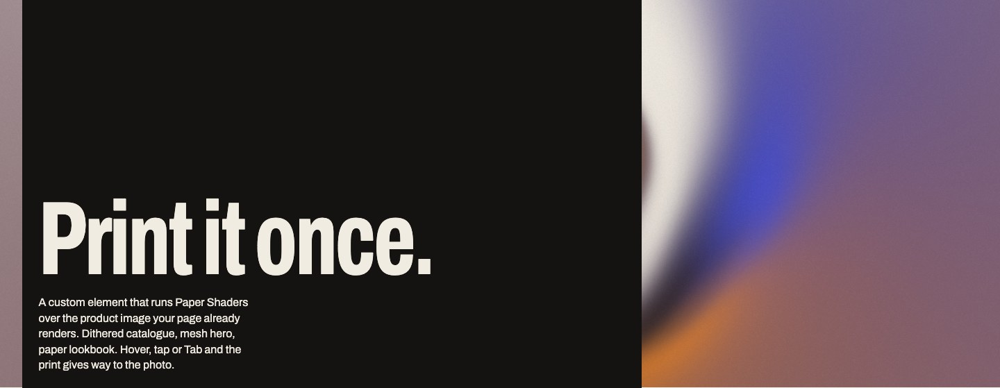
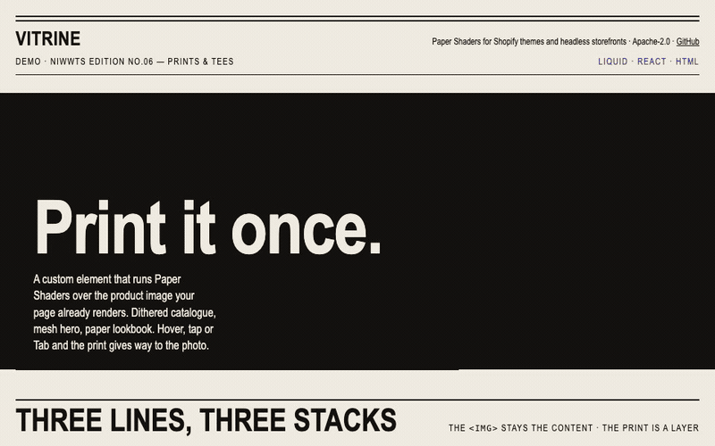
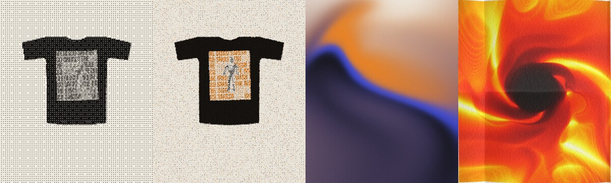
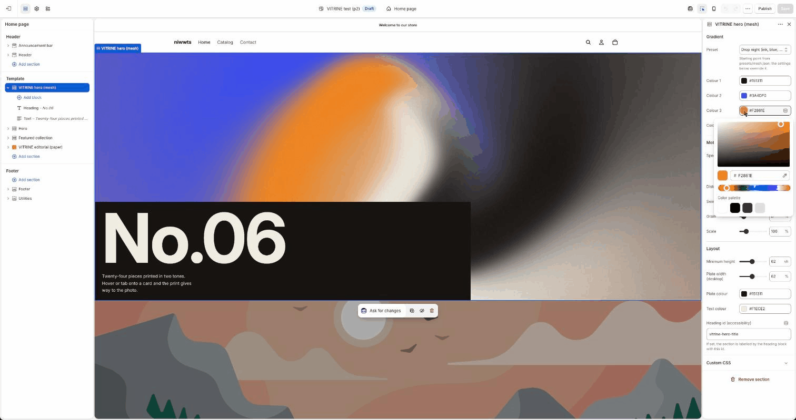
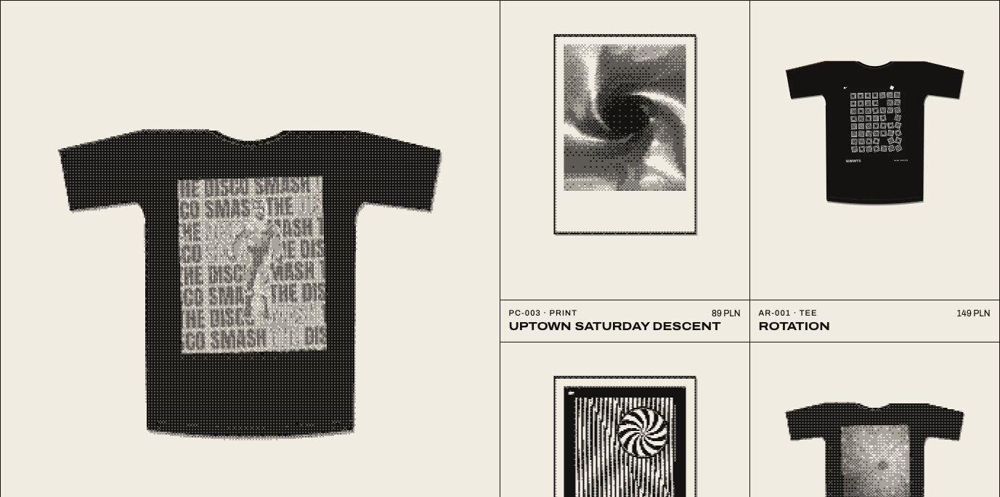

<p align="center">
  
</p>

<h1 align="center">VITRINE</h1>

<p align="center">
  Paper Shaders for Shopify themes and headless storefronts.<br />
  One <code>&lt;vitrine-shader&gt;</code> element for Liquid, React 19 / Next.js and plain HTML.
</p>

<p align="center">
  <a href="LICENSE"></a>
  
  
  
  
</p>

<!--
  TODO_PAGES_URL: make the repo public (gh repo edit PiotrekFilipecki/vitrine --visibility public
  --accept-visibility-change-consequences), then Settings → Pages → Build and deployment → Source: "GitHub Actions",
  then Actions → "Pages (static demo)" → Run workflow (or push to main). Expected URL:
  https://piotrekfilipecki.github.io/vitrine/examples/static/
  TODO_VERCEL_URL: vercel.com → Add New → Project → import PiotrekFilipecki/vitrine → Root Directory
  examples/next-headless → Framework Next.js → Deploy (no env vars: the example runs on repo fixtures; for the
  Storefront API add the two variables from examples/next-headless/.env.example). Paste the production URL here.
-->
<p align="center">
  <a href="TODO_PAGES_URL"><b>Live demo (static HTML)</b></a> ·
  <a href="TODO_VERCEL_URL"><b>Headless demo (Next.js)</b></a>
</p>

<p align="center">
  
</p>

VITRINE prints the product image your page already renders, in dithering, halftone, mesh gradient or paper texture,
and gives the photo back on hover, tap or focus. The `` stays the content; the print is a layer on top of it.
Built on [Paper Shaders](https://shaders.paper.design) (Apache-2.0). Demo catalogue: NIWWTS edition No.06, prints
and tees by Piotr Filipecki.

## Four effects, one element

<p align="center">
  
</p>

| `effect`   | Paper shader    | Preset that ships                              | Where it goes   | Rendered     |
| ---------- | --------------- | ---------------------------------------------- | --------------- | ------------ |
| `dither`   | image-dithering | `newsprint` (8×8 Bayer, 3 tones, `whitePoint`) | product cards   | once, cached |
| `halftone` | halftone-cmyk   | `riso` (orange + ink, no cyan)                 | product page    | once, cached |
| `mesh`     | mesh-gradient   | `drop-night` / `acid-night`                    | collection hero | live, pooled |
| `paper`    | paper-texture   | `folded-lookbook` (one fold, light from 300°)  | editorial image | once, cached |

Presets live in [`presets/*.json`](presets) and feed the element, the Liquid section schemas and the React wrappers.
`params` overrides use the same prop names as `@paper-design/shaders-react`. One option is VITRINE's own: `whitePoint`
on `dither` prints a light mockup background as clean paper instead of a dot screen (off by default; with it off the
upstream shader runs unchanged, see [`docs/vitrine/API.md`](docs/vitrine/API.md)).

## Quick start

### Shopify theme (Online Store 2.0, tested on Horizon 4.3.0)

```liquid

```

1. Copy `shopify-theme/assets`, `sections` and `snippets` into your theme.
2. Paste the object from `shopify-theme/settings_schema.fragment.json` into `config/settings_schema.json`.
3. Wrap the card image with the snippet (Horizon: `snippets/product-media.liquid`, lines 40–54, when
   `preview_image_only`), and add `data-vitrine-card` to `<product-card>` in `snippets/product-card.liquid`.
4. `shopify theme push --unpublished`, then add **VITRINE hero (mesh)** and **VITRINE editorial (paper)** in the editor.

Full install, Dawn notes and the settings → parameter map: [`shopify-theme/README.md`](shopify-theme/README.md).

<p align="center">
  
</p>

### React 19 / Next.js

```tsx
import { ProductMediaShader } from 'vitrine-shaders/react';

<Link href={`/products/${product.handle}`}>
  <ProductMediaShader image={product.featuredImage} effect="dither" preset="newsprint" reveal="hover">
    <Image
      src={product.featuredImage.url}
      alt={product.featuredImage.altText ?? ''}
      width={1600}
      height={1920}
    />
  </ProductMediaShader>
</Link>;
```

The server renders a plain image; the element loads after hydration as its own chunk (the wrapper is 860 B gzip).
`CollectionHeroShader` (mesh) and `EditorialImageShader` (paper) work the same way. Example:
[`examples/next-headless`](examples/next-headless).

### Plain HTML

```html
<script type="module">
  import 'vitrine-shaders';
</script>

<a href="/products/el-funkador-tee">
  <vitrine-shader effect="dither" preset="newsprint" reveal="hover">
    
  </vitrine-shader>
</a>
```

## How it works

- **The image stays the content.** It is what loads first, what LCP measures, what screen readers and search engines
  get, and what remains without WebGL2 or CORS. The effect is an `aria-hidden` layer on top of it.
- **Printed once, zero live contexts.** Browsers evict WebGL contexts after about sixteen. Static effects are
  rendered through one shared off-screen context per effect, read back asynchronously (pixel-pack buffer + fence),
  encoded to PNG in a worker and cached by image, parameters, size and DPR. A 24-card grid ends with 0 live contexts.
- **Off the critical path.** Each bake gets its own task: cards near the viewport first, one per frame, the rest in
  idle time. The main thread spends 2–18 ms per card on the demo page (software GL, Lighthouse's Chromium).
- **Animated effects are pooled.** The hero mounts only in the viewport, at most `maxLive` (6) at once, LRU; a lost
  context is remounted.
- **Reveal = hover = focus.** The nearest `[data-vitrine-card]` or link is the surface; keyboard users get the photo
  too. `prefers-reduced-motion` makes every effect static and removes the transition.
- **Fallbacks are silent.** No WebGL2, no CORS header, a broken texture: the photo stays, nothing is logged
  (`vitrine:fallback` fires if you want to know).

<p align="center">
  
</p>

## Measured

Lighthouse mobile (Moto G Power emulation, CPU ×4, simulated slow 4G), median of three runs, the same HTML with and
without the element. The demo page loads the element after the hero photo has painted; the stress page imports it
straight away.

| Page                                                       | With VITRINE                   | Without              | LCP delta |
| ---------------------------------------------------------- | ------------------------------ | -------------------- | --------- |
| Static demo, 12 cards + proof print (`examples/static`)    | 96 · LCP 2 778 ms · TBT 63 ms  | 96 · 2 778 ms · 0 ms | 0 ms      |
| Stress page, 24 cards from 1600 px originals + live mesh   | 88 · LCP 3 604 ms · TBT 179 ms | 93 · 3 229 ms · 0 ms | +375 ms   |
| Next.js 16, 24 cards + hero                                | 96 · LCP 756 ms · TBT 236 ms   | 100 · 756 ms · 9 ms  | 0 ms      |
| Shopify Horizon collection, 12 cards, CDN preview (v0.1.0) | 100 · LCP 1 808 ms · CLS 0     | 99 · 1 938 ms        | −130 ms   |

CLS is 0 on the three local pages. The Horizon row is the v0.1.0 element, measured on the dev store in P2; the theme
asset has not been re-measured there since. The Next row is worse than v0.1.0 on the same machine (99, TBT 148 ms):
the remaining long tasks are compositor commits, not bakes (details in the Q0 devlog).

Pixel compatibility with `@paper-design/shaders-react`: 0 different pixels on 8 effect/preset cases (Chromium, WebKit).
Bundle, gzip: core 16.4 KB, dither 3.3 KB, halftone 4.1 KB, mesh 2.3 KB, paper 6.4 KB, noise texture 18.3 KB
(halftone and paper only); React wrappers 870 B; single-file theme asset 46.1 KB. Every number, with the method, is in
[`docs/vitrine/devlog`](docs/vitrine/devlog).

## API in short

| Attribute | Values                                   | Notes                                                                  |
| --------- | ---------------------------------------- | ---------------------------------------------------------------------- |
| `effect`  | `dither` · `halftone` · `mesh` · `paper` | required                                                               |
| `preset`  | id from `presets/<effect>.json`          | `default` = the upstream default 1:1                                   |
| `params`  | JSON object                              | overrides, `@paper-design/shaders-react` prop names                    |
| `reveal`  | `hover` · `none`                         | pointer, tap or focus on the nearest `[data-vitrine-card]` or link     |
| `speed`   | number                                   | `0` = rendered once, no live context; anything else = animated, pooled |

Events `vitrine:ready` and `vitrine:fallback`; `data-vitrine-state` on the element; `VitrineShader.config()` for the
pool size and the bake idle timeout. Full reference: [`docs/vitrine/API.md`](docs/vitrine/API.md).

## Made with Paper

The demo page layout was designed on the Paper canvas before it was coded. The presets started as frames in Paper and
were picked on renders of the element on the NIWWTS catalogue; the proof print at the top of the demo was added later,
in code. Frames, variants and before/after values: [`docs/vitrine/process.md`](docs/vitrine/process.md).

## Repo

```
packages/element      the <vitrine-shader> element (published as vitrine-shaders)
packages/react        React 19 wrappers (published as vitrine-shaders/react)
shopify-theme/        sections, snippets, assets/vitrine.js: copy into a theme
presets/              JSON presets shared by every stack
examples/static       plain HTML demo (index.html) and the 24-card stress page, no bundler
examples/next-headless  Next.js 16 store on the Storefront API or on fixtures
docs/                 plan, ADR, devlogs with every measurement, process notes
```

Contributions: [`ROADMAP.md`](ROADMAP.md) lists what comes next (theme app extension, more effects, chunked theme
asset, Svelte/Vue wrappers, community presets).

## Limits

- WebGL2 is required for the effect; without it the page shows the image.
- Cross-origin images need `Access-Control-Allow-Origin` (Shopify's CDN sends `*`; `next/image` makes them
  same-origin anyway).
- Firefox is unmeasured.

## Licence

Apache-2.0 © 2026 Piotr Filipecki. Paper Shaders' `LICENSE` and `NOTICE` are in `third_party/paper-shaders/` and in
the header of every built file. Powered by [Paper Shaders](https://shaders.paper.design).
