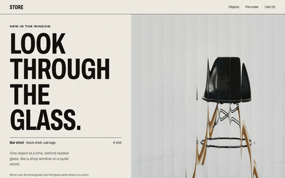
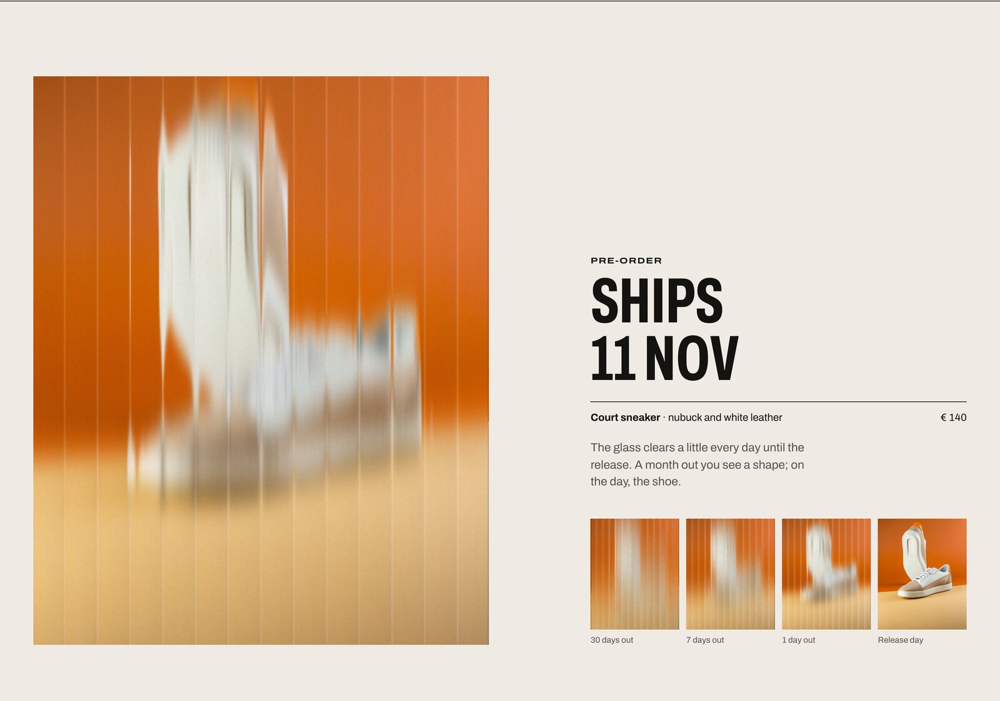
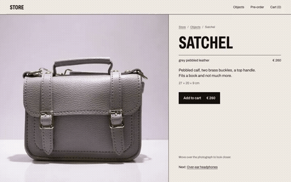
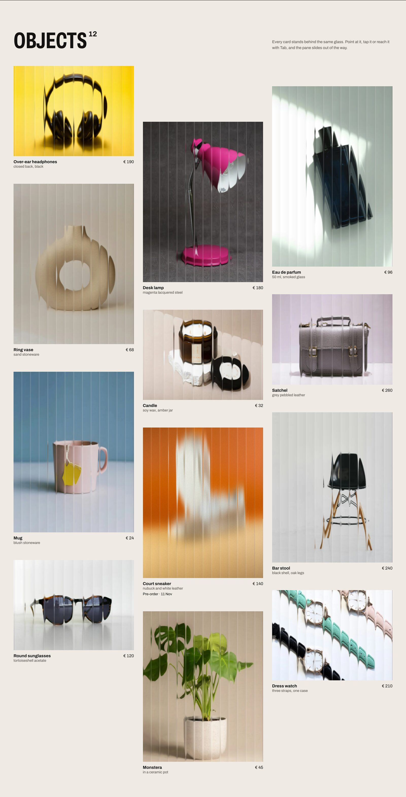

<p align="center">
  
</p>

<h1 align="center">VITRINE</h1>

<p align="center">
  Paper Shaders for Shopify themes and headless storefronts.<br />
  One <code>&lt;vitrine-shader&gt;</code> element for Liquid, React 19 / Next.js and plain HTML.
</p>

<p align="center">
  <a href="LICENSE"></a>
  
  
  
  
</p>

<p align="center">
  <a href="https://piotrekfilipecki.github.io/vitrine/examples/static/"><b>Live demo (static HTML)</b></a> ·
  <a href="https://vitrine-hazel-three.vercel.app/"><b>Headless demo (Next.js)</b></a>
</p>

<p align="center">
  
</p>

VITRINE puts your product photos behind reeded shop-window glass that slides away under the cursor, frosts a
pre-order card until its release date, and gives the product page a loupe. The `` your page already renders
stays the content; the effect is a layer on top of it. Built on [Paper Shaders](https://shaders.paper.design)
(Apache-2.0). The demo is "Store", a made-up shop with twelve product photographs from Unsplash.

## Three moments in a shop

| Moment             | Markup                                  | At rest                                      | On interaction                                                                                   |
| ------------------ | --------------------------------------- | -------------------------------------------- | ------------------------------------------------------------------------------------------------ |
| Product card       | `effect="glass" preset="window"`        | the glass, rendered once, no live context    | hover, tap or keyboard focus: the pane slides away (520 ms), back on leave (380 ms), one context |
| Pre-order card     | `effect="glass" bind="date:2026-12-01"` | frosted by the days left: 30 → 7 → 1 → clear | nothing: the frost is the message                                                                |
| Product page image | `effect="lens" preset="loupe"`          | the plain photo, no context                  | a round loupe (2.2×) under the mouse, or under a finger held still                               |

<p align="center">
  
</p>

<p align="center">
  
</p>

The v0.1 effects are still in the element for graphic brands that want a print look: `dither` (image-dithering),
`halftone` (halftone-cmyk), `mesh` (mesh-gradient), `paper` (paper-texture). Presets for all of them live in
[`presets/*.json`](presets) and feed the element, the Liquid snippets and the React wrappers.

## Quick start

### Shopify theme (Online Store 2.0, tested on Horizon 4.3.0)

```liquid



```

1. Copy `shopify-theme/assets` and `shopify-theme/snippets` into your theme.
2. Render the snippets where your theme prints the card image and the main product image (Horizon:
   `snippets/product-media.liquid`, lines 40–54, when `preview_image_only`); add `data-vitrine-card` to
   `<product-card>` in `snippets/product-card.liquid` so focus anywhere on the card opens the glass.
3. Pre-orders: create the product metafield `custom.release_date` (Settings → Custom data → Products, type _Date_ or
   _Date and time_) and fill it on each pre-order product.

Full install, Dawn notes and the v0.1 sections: [`shopify-theme/README.md`](shopify-theme/README.md).

### React 19 / Next.js

```tsx
import { GlassProductImage, LoupeImage, PreorderGlassImage } from 'vitrine-shaders/react';

<Link href={`/products/${p.handle}`}>
  <GlassProductImage image={p.featuredImage}>
    <Image src={p.featuredImage.url} alt="" width={1600} height={2000} sizes="33vw" />
  </GlassProductImage>
</Link>;

<PreorderGlassImage image={p.featuredImage} releaseDate="2026-12-01" />;

<LoupeImage image={p.featuredImage} zoom={2.5} />;
```

The server renders a plain image; the element loads after hydration as its own chunk. Example store with the
Storefront API or repo fixtures: [`examples/next-headless`](examples/next-headless).

### Plain HTML

```html
<script type="module">
  import 'vitrine-shaders';
</script>

<a href="/products/bar-stool">
  <vitrine-shader effect="glass" preset="window">
    
  </vitrine-shader>
  Bar stool · € 240
</a>
```

## How it works

- **The image stays the content.** It is what loads first, what LCP measures, what screen readers and search engines
  get, and what remains without WebGL2 or CORS. The effect is an `aria-hidden` layer on top of it.
- **Zero live contexts at rest.** Browsers evict WebGL contexts after about sixteen. The glass at rest and the frosted
  pre-order card are rendered once through one shared off-screen context and cached; the loupe does not exist until a
  pointer arrives. A page of cards ends with 0 live contexts.
- **The hero's doors.** With `params='{"doors":true}'` two panes part where the cursor points and open fully on a tap,
  on the same single context: a small patch on the upstream shader cuts the gap, and the resting frame still comes
  from the unpatched shader.
- **One context while something moves.** The glass transition and the loupe share a single slot: a second interaction
  takes it over and the first jumps to its end state. The fresh context paints under the identical baked frame
  before the pane starts to move, so its start-up frame never lands in the motion.
- **Off the critical path.** Each bake gets its own task (cards near the viewport first, the rest in idle time), the
  frame is read back asynchronously and encoded to PNG in a worker.
- **Accessible by default.** The card opens on keyboard focus like it does on hover; on a phone the first tap opens
  the glass and the second follows the link. `prefers-reduced-motion` opens and closes it at once, without a context.
  The loupe is decoration: it never takes focus, the image keeps its alt.
- **Fallbacks are silent.** No WebGL2, no CORS header, a broken texture: the photo stays, nothing is logged
  (`vitrine:fallback` fires if you want to know).

<p align="center">
  
</p>

## Measured

Lighthouse mobile (Moto G Power emulation, CPU ×4, simulated slow 4G), median of three runs, the same HTML with and
without the element.

| Page                                                 | With VITRINE                  | Without               |
| ---------------------------------------------------- | ----------------------------- | --------------------- |
| Static demo "Store", 18 elements (`examples/static`) | 99 · LCP 2 103 ms · TBT 29 ms | 98 · 2 478 ms · 0 ms  |
| Next.js 16 "Store" (`examples/next-headless`)        | 96 · LCP 2 782 ms · TBT 45 ms | 99 · 2 031 ms · 10 ms |

CLS is 0 on both. LCP is the same hero `` with and without the element, so the deltas are Lighthouse's run-to-run
spread, not a gain (Next, with: 2 031–3 262 ms, without: 1 808–2 856 ms). While the glass moves (Chrome, CPU ×4, 1440
px at 2×): a card renders at 16.7 ms per frame; the full-height hero doors at a 33.3 ms median. A fresh context
starts with one long frame (167–400 ms) before anything moves, under the identical baked picture. Live WebGL contexts
after load: 0.

Pixel compatibility with `@paper-design/shaders-react` 0.0.82: 13 effect/preset cases, at most 0.0067 % different
pixels (Chromium, WebKit). Bundle, gzip: core 22.6 KB (index + static chunks), interactions 4.4 KB (only with glass or
lens), glass 5.0 KB, lens 3.9 KB; React wrappers under 1 KB; single-file theme asset 56.6 KB. Every number, with the method, is in [`docs/vitrine/devlog`](docs/vitrine/devlog).

## API in short

| Attribute | Values                                                      | Notes                                                                                     |
| --------- | ----------------------------------------------------------- | ----------------------------------------------------------------------------------------- |
| `effect`  | `glass` · `lens` · `dither` · `halftone` · `mesh` · `paper` | required                                                                                  |
| `preset`  | id from `presets/<effect>.json`                             | `default` = the upstream default 1:1; `window`, `loupe` = the shop presets                |
| `params`  | JSON object                                                 | overrides, `@paper-design/shaders-react` prop names (+ `loupeSize`, `zoom`, `whitePoint`) |
| `reveal`  | `hover` · `tap` · `none`                                    | glass defaults to `hover` (pointer, tap, keyboard focus)                                  |
| `bind`    | `pointer` · `date:<to>` · `date:<from>/<to>` · `none`       | lens defaults to `pointer`; dates are ISO 8601                                            |
| `speed`   | number                                                      | v0.1 effects: `0` = rendered once; anything else = animated, pooled                       |

Events `vitrine:ready` and `vitrine:fallback`; `data-vitrine-state` on the element; `VitrineShader.config()` and
`VitrineShader.stats()`. Full reference: [`docs/vitrine/API.md`](docs/vitrine/API.md). Why these three effects and
not more: [`docs/adr/0003-v02-trzy-efekty.md`](docs/adr/0003-v02-trzy-efekty.md).

## Repo

```
packages/element        the <vitrine-shader> element (published as vitrine-shaders)
packages/react          React 19 wrappers (published as vitrine-shaders/react)
shopify-theme/          snippets, sections, assets/vitrine.js: copy into a theme
presets/                JSON presets shared by every stack
examples/static         "Store" in plain HTML, no bundler (home + 12 product pages)
examples/next-headless  "Store" on Next.js 16, Storefront API or fixtures
examples/fixtures       12 product photographs (Unsplash License, CREDITS.md) and the shared catalogue
docs/                   plan, ADRs, devlogs with every measurement
```

Contributions: [`ROADMAP.md`](ROADMAP.md) lists what comes next.

## Limits

- WebGL2 is required for the effect; without it the page shows the image.
- Cross-origin images need `Access-Control-Allow-Origin` (Shopify's CDN sends `*`; `next/image` makes them
  same-origin anyway).
- The glass expects the `` to cover its box like `object-fit: cover`, centred (that is how the shader crops).
- Firefox is not measured on the development machine; Chromium and WebKit are.

## Credits and licence

Product photographs: Unsplash License, photographers listed in
[`examples/fixtures/CREDITS.md`](examples/fixtures/CREDITS.md). Code: Apache-2.0 © 2026 Piotr Filipecki. Paper
Shaders' `LICENSE` and `NOTICE` are in `third_party/paper-shaders/` and in the header of every built file. Powered by
[Paper Shaders](https://shaders.paper.design).
