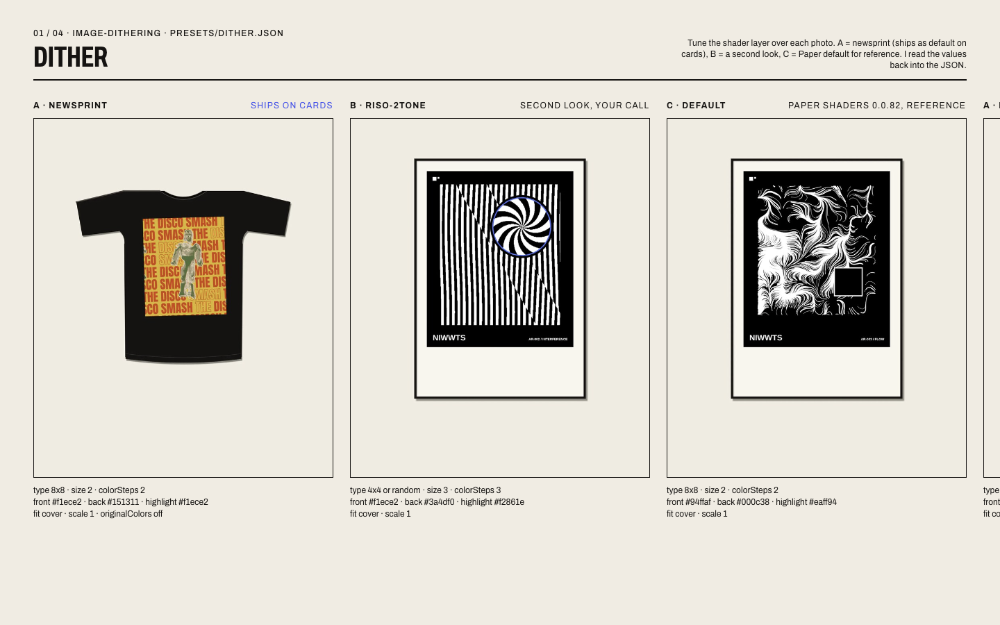

# How VITRINE was made with Paper

VITRINE is a bridge between [Paper Shaders](https://shaders.paper.design) and Shopify. "Made with Paper" is a condition
of the Codrops guide entry, not decoration, so this page records what was done on the Paper canvas, what the agent did
and what Piotr did. Screenshots live in `docs/media/p4-*`.

## 1. Presets: tuned on the canvas, read back into JSON

The four effects (image-dithering, halftone-cmyk, mesh-gradient, paper-texture) each got one 1440 px frame in the
Paper file **"VITRINE — presets"**: three variants per effect on NIWWTS No.06 product photos, with the starting
parameters printed under every slot.

- **Agent:** built the frames through the Paper MCP (tokens for the NIWWTS palette and Archivo, one frame, three
  slots with the photos, then duplicated and relabelled for the other effects). Starting values = the P1 drafts in
  `presets/*.json`; C = Paper's own default preset kept 1:1 as a reference.
- **Piotr:** adds the shader layer over each photo in Paper and tunes it by eye (40 minutes). A = the preset that
  ships (`newsprint`, `riso`, `drop-night`, `folded-lookbook`), B = a second look, C = untouched.
- **Agent, after "gotowe":** reads the layer parameters back (MCP, or the React export in
  `docs/vitrine/paper-export/` as plan B) and writes `presets/*.json`. The pixel-compatibility tests from P1 run on
  the new values, so a preset that renders differently from shaders-react cannot ship.

| Frame | Before (P1 draft) | After tuning |
| --- | --- | --- |
| dither · newsprint | 8×8 Bayer, size 2, 2 steps, ink on paper | PENDING_TUNING |
| halftone · riso | C blue-rice, M orange, Y off, K ink, size 0.3 | PENDING_TUNING |
| mesh · drop-night | ink, blue-rice, orange, paper; distortion 0.9, swirl 0.25, speed 0.6 | PENDING_TUNING |
| paper · folded-lookbook | cover, blending 0.9, one fold (0.6), crumples 0.6, seed 49 | PENDING_TUNING |

## 2. Demo page: designed on the canvas, then coded

Page **"Demo page"** in the same file holds two artboards, 1440 and 390: masthead, hero ("Print it once." on an
ink plate over the mesh), "Three lines, three stacks" (Liquid / React / HTML code columns of different widths),
the catalogue sheet with a two-column lead card and a closing ink plate, and "Made with Paper." with the effect
table. Photos in the mock are real fixtures; the dithered cards are ImageMagick ordered-dither approximations so the
layout could be judged before the shader layers existed; the hero is a frame of the live mesh.

- Lock (taste-guardrail): the NIWWTS print sheet from P1 pushed towards "instructions in the box"; Archivo on the
  width axis (62 % display, 100 % text, 125 % labels); paper, ink, one accent (blue-rice) in text, No.06 orange only
  as a surface; grid broken by the plate over the mesh, the lead card and the unequal code columns; the one
  signature is the print lifting under the cursor. Negative: not a shadcn docs page, not "Welcome to VITRINE".
- The code (`examples/static/index.html`, `styles.css`) was then updated from the canvas: the same sections, the same
  copy, the same proportions (38/62 editorial and credit, 38/29/27 columns). The editorial paper section from P1
  stays between the catalogue and the credit so all four effects are on one page.

Compare: `docs/media/p4-paper-demo-1440.png` (canvas) vs `docs/media/p4-demo-1440.png` (code), and the 390 pair.

## 3. What the agent did, what Piotr did

| | Agent | Piotr |
| --- | --- | --- |
| Paper file, tokens, frames, labels, photos | ✔ | |
| Shader layers and tuning | | ✔ (X1) |
| Reading values back, JSON, compatibility tests | ✔ | |
| Demo page layout and copy on the canvas | ✔ | review |
| Code from the canvas, screenshots, GIFs | ✔ | gate on the phone |

## 4. Notes for the write-up

- Paper MCP imports JPG assets reliably; WebP and 8-bit PNG timed out or came in as "Missing image", so the assets
  were converted first.
- The mesh cannot be previewed as a shader through the MCP; the mock uses a frame of the live element, and the real
  shader layer is Piotr's step.
- Everything numeric on the page comes from the devlogs (P1–P3), nothing is rounded up.
